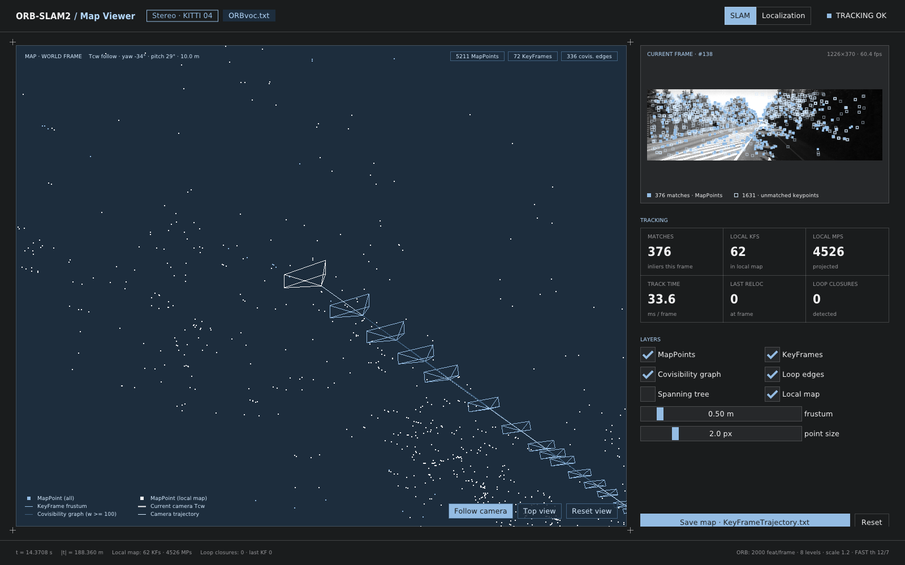

# ORB-SLAM2

**Original authors:** [Raul Mur-Artal](http://webdiis.unizar.es/~raulmur/), [Juan D. Tardos](http://webdiis.unizar.es/~jdtardos/), [J. M. M. Montiel](http://webdiis.unizar.es/~josemari/) and [Dorian Galvez-Lopez](http://doriangalvez.com/) ([DBoW2](https://github.com/dorian3d/DBoW2))

ORB-SLAM2 is a real-time SLAM library for **Monocular**, **Stereo** and **RGB-D** cameras
that computes the camera trajectory and a sparse 3D reconstruction (in the stereo and
RGB-D case with true scale). It detects loops and relocalizes the camera in real time.
Examples are provided for the [KITTI](http://www.cvlibs.net/datasets/kitti/eval_odometry.php),
[TUM](http://vision.in.tum.de/data/datasets/rgbd-dataset) and
[EuRoC](http://projects.asl.ethz.ch/datasets/doku.php?id=kmavvisualinertialdatasets)
datasets.

## About this fork

This is a modernization fork. The algorithm is upstream ORB-SLAM2; the platform around it
is not:

| | upstream | this fork |
|---|---|---|
| Standard | C++11 | **C++20** |
| Build | CMake + `build.sh` shims | **[cabin](https://cabinpkg.com)** (`cabin.toml`) |
| OpenCV | 2.4 / 3.x | **4.x** |
| Visualization | Pangolin, built in | **a separate GLFW + Dear ImGui binary** — the libraries are headless |
| ROS | optional `Examples/ROS` | **removed** |
| Tests | none | **116 GoogleTest cases** + a KITTI evaluation script |
| Layout | flat `include/`, `src/` | **module directories**, two libraries |

The GUI is `orbslam2_viewer`, a *separate executable* reading a snapshot API. Neither
`orbslam2_core` nor `orbslam2_slam` links a windowing system, and neither should start.



### Related publications

[Monocular] Raúl Mur-Artal, J. M. M. Montiel and Juan D. Tardós. **ORB-SLAM: A Versatile and Accurate Monocular SLAM System**. *IEEE Transactions on Robotics,* vol. 31, no. 5, pp. 1147-1163, 2015. (**2015 IEEE Transactions on Robotics Best Paper Award**). **[PDF](http://webdiis.unizar.es/~raulmur/MurMontielTardosTRO15.pdf)**.

[Stereo and RGB-D] Raúl Mur-Artal and Juan D. Tardós. **ORB-SLAM2: an Open-Source SLAM System for Monocular, Stereo and RGB-D Cameras**. *IEEE Transactions on Robotics,* vol. 33, no. 5, pp. 1255-1262, 2017. **[PDF](https://128.84.21.199/pdf/1610.06475.pdf)**.

[DBoW2 Place Recognizer] Dorian Gálvez-López and Juan D. Tardós. **Bags of Binary Words for Fast Place Recognition in Image Sequences**. *IEEE Transactions on Robotics,* vol. 28, no. 5, pp.  1188-1197, 2012. **[PDF](http://doriangalvez.com/php/dl.php?dlp=GalvezTRO12.pdf)**

# 1. License

ORB-SLAM2 is released under a [GPLv3 license](License-gpl.txt). For a list of all
code/library dependencies (and associated licenses), see [Dependencies.md](Dependencies.md).

For a closed-source version of ORB-SLAM2 for commercial purposes, please contact the
original authors: orbslam (at) unizar (dot) es.

If you use ORB-SLAM2 (Monocular) in an academic work, please cite:

    @article{murTRO2015,
      title={{ORB-SLAM}: a Versatile and Accurate Monocular {SLAM} System},
      author={Mur-Artal, Ra\'ul, Montiel, J. M. M. and Tard\'os, Juan D.},
      journal={IEEE Transactions on Robotics},
      volume={31},
      number={5},
      pages={1147--1163},
      doi = {10.1109/TRO.2015.2463671},
      year={2015}
     }

if you use ORB-SLAM2 (Stereo or RGB-D) in an academic work, please cite:

    @article{murORB2,
      title={{ORB-SLAM2}: an Open-Source {SLAM} System for Monocular, Stereo and {RGB-D} Cameras},
      author={Mur-Artal, Ra\'ul and Tard\'os, Juan D.},
      journal={IEEE Transactions on Robotics},
      volume={33},
      number={5},
      pages={1255--1262},
      doi = {10.1109/TRO.2017.2705103},
      year={2017}
     }

# 2. Prerequisites

Tested on Linux with GCC 15. A machine with several cores ensures real-time performance.

- **A C++20 compiler.** `std::jthread` and the rest of C++20 are used.
- **[cabin](https://cabinpkg.com)** — the build system.
- **OpenCV 4** — images and features.
- **Eigen3** (>= 3.1.0) — required by g2o.
- **GoogleTest / GoogleMock** — only for `cabin test`.
- **GLFW3** (>= 3.3) and **OpenGL** — only for `orbslam2_viewer`.

OpenCV, Eigen and GoogleMock are declared `system = true` in `cabin.toml`, meaning cabin
finds them through **pkg-config** (`opencv4`, `eigen3`, `gmock_main`, `glfw3`, `gl`) rather than fetching
them. Install them with your OS package manager; a "package not found" error from
`cabin build` means the corresponding `.pc` file is missing.

**DBoW2 and g2o** are *modified* forks vendored in `Thirdparty/` and built as part of this
package. Do not substitute distribution packages — the modifications are load-bearing.
**Dear ImGui** (v1.91.5, upstream GLFW/OpenGL3 backends) is vendored too, because it ships
no pkg-config file. The modern GL entry points come from `GL_GLEXT_PROTOTYPES` and
libglvnd, so there is deliberately no glad, glew or epoxy.

No Pangolin. No ROS.

# 3. Building

```bash
git clone <this repository> ORB_SLAM2
cd ORB_SLAM2
chmod +x build.sh
./build.sh
```

`build.sh` untars the vocabulary and runs `cabin build --release`. It is idempotent. For
an incremental rebuild, `cabin build --release` directly (or `cabin check` for a fast
syntax-only pass).

> **Parallelism:** `build.sh` caps the build at 12 jobs (`CABIN_BUILD_JOBS`). On WSL2,
> saturating every core takes the WSL service down mid-build. Export the variable
> yourself to override.

This produces, all in `build/release/packages/ORB_SLAM2/`:

- **liborbslam2_core.a**, **liborbslam2_slam.a**, **libDBoW2.a**, **libg2o.a**
- **mono_tum**, **mono_kitti**, **mono_euroc**, **stereo_kitti**, **stereo_euroc**, **rgbd_tum**
- **orbslam2_viewer** — the GUI, see section 9

Cabin has no shared-library kind, and unlike the old CMake build it does not write
binaries into `Examples/`.

## `-march=native` is an ABI flag here

Use `cabin build --profile native`. The flag necessarily applies to every target at once,
which is what makes it safe: `-march=native` raises `EIGEN_MAX_ALIGN_BYTES` (16 → 64 on
AVX-512), changing the size and alignment of Eigen-containing types such as
`g2o::SE3Quat`. **The setting must be identical across DBoW2, g2o and the two orbslam2
libraries** — mixing it segfaults inside `g2o::BaseVertex::push` during the first global
bundle adjustment, with no build-time warning.

# 4. Source layout

Headers live at `include/orbslam/<module>/<Name>.hpp`, sources at
`src/<module>/<Name>.cpp`, and includes spell the full path:

```cpp
#include <orbslam/system/System.hpp>
```

```
core/          Map MapPoint KeyFrame Frame Converter        ─┐ liborbslam2_core.a
features/      ORBextractor ORBmatcher ORBVocabulary        ─┘
               KeyFrameDatabase
tracking/      Tracking Initializer                         ─┐
mapping/       LocalMapping                                  │
loop_closing/  LoopClosing                                   ├ liborbslam2_slam.a
optimization/  Optimizer PnPsolver Sim3Solver                │
system/        System                                       ─┘

apps/viewer/   Snapshot Viewer main                          ─ orbslam2_viewer
```

`orbslam2_slam` depends on `orbslam2_core`, and **nothing depends back** — that one-way
edge is the point of the split. Every public header is self-contained: it compiles
standalone and does not rely on include order.

`System` is the only public entry point. Its constructor builds the map and spawns the
Local Mapping and Loop Closing threads; the caller's own thread becomes the tracking
thread by calling `TrackMonocular` / `TrackStereo` / `TrackRGBD` once per frame, each
returning the camera pose `Tcw` (a 4x4 `CV_32F` world-to-camera matrix, empty if tracking
failed).

# 5. Monocular Examples

## TUM Dataset

1. Download a sequence from http://vision.in.tum.de/data/datasets/rgbd-dataset/download and uncompress it.

2. Execute the following command. Change `TUMX.yaml` to TUM1.yaml, TUM2.yaml or TUM3.yaml for freiburg1, freiburg2 and freiburg3 sequences respectively. Change `PATH_TO_SEQUENCE_FOLDER` to the uncompressed sequence folder.
```
./build/release/packages/ORB_SLAM2/mono_tum Vocabulary/ORBvoc.txt Examples/Monocular/TUMX.yaml PATH_TO_SEQUENCE_FOLDER
```

## KITTI Dataset

1. Download the dataset (grayscale images) from http://www.cvlibs.net/datasets/kitti/eval_odometry.php

2. Execute the following command. Change `KITTIX.yaml` to KITTI00-02.yaml, KITTI03.yaml or KITTI04-12.yaml for sequences 00 to 02, 03, and 04 to 12 respectively. Change `PATH_TO_DATASET_FOLDER` to the uncompressed dataset folder. Change `SEQUENCE_NUMBER` to 00, 01, 02, .., 11.
```
./build/release/packages/ORB_SLAM2/mono_kitti Vocabulary/ORBvoc.txt Examples/Monocular/KITTIX.yaml PATH_TO_DATASET_FOLDER/dataset/sequences/SEQUENCE_NUMBER
```

## EuRoC Dataset

1. Download a sequence (ASL format) from http://projects.asl.ethz.ch/datasets/doku.php?id=kmavvisualinertialdatasets

2. Execute the following first command for V1 and V2 sequences, or the second command for MH sequences. Change PATH_TO_SEQUENCE_FOLDER and SEQUENCE according to the sequence you want to run.
```
./build/release/packages/ORB_SLAM2/mono_euroc Vocabulary/ORBvoc.txt Examples/Monocular/EuRoC.yaml PATH_TO_SEQUENCE_FOLDER/mav0/cam0/data Examples/Monocular/EuRoC_TimeStamps/SEQUENCE.txt
```

```
./build/release/packages/ORB_SLAM2/mono_euroc Vocabulary/ORBvoc.txt Examples/Monocular/EuRoC.yaml PATH_TO_SEQUENCE/cam0/data Examples/Monocular/EuRoC_TimeStamps/SEQUENCE.txt
```

# 6. Stereo Examples

## KITTI Dataset

1. Download the dataset (grayscale images) from http://www.cvlibs.net/datasets/kitti/eval_odometry.php

2. Execute the following command. Change `KITTIX.yaml` to KITTI00-02.yaml, KITTI03.yaml or KITTI04-12.yaml for sequences 00 to 02, 03, and 04 to 12 respectively. Change `PATH_TO_DATASET_FOLDER` to the uncompressed dataset folder. Change `SEQUENCE_NUMBER` to 00, 01, 02, .., 11.
```
./build/release/packages/ORB_SLAM2/stereo_kitti Vocabulary/ORBvoc.txt Examples/Stereo/KITTIX.yaml PATH_TO_DATASET_FOLDER/dataset/sequences/SEQUENCE_NUMBER
```

**Pairing the settings file to the sequence matters.** `KITTI00-02.yaml` and
`KITTI04-12.yaml` carry different `Camera.fx` and `Camera.bf`; using the wrong one
silently rescales the entire trajectory instead of failing.

## EuRoC Dataset

1. Download a sequence (ASL format) from http://projects.asl.ethz.ch/datasets/doku.php?id=kmavvisualinertialdatasets

2. Execute the following first command for V1 and V2 sequences, or the second command for MH sequences. Change PATH_TO_SEQUENCE_FOLDER and SEQUENCE according to the sequence you want to run.
```
./build/release/packages/ORB_SLAM2/stereo_euroc Vocabulary/ORBvoc.txt Examples/Stereo/EuRoC.yaml PATH_TO_SEQUENCE/mav0/cam0/data PATH_TO_SEQUENCE/mav0/cam1/data Examples/Stereo/EuRoC_TimeStamps/SEQUENCE.txt
```
```
./build/release/packages/ORB_SLAM2/stereo_euroc Vocabulary/ORBvoc.txt Examples/Stereo/EuRoC.yaml PATH_TO_SEQUENCE/cam0/data PATH_TO_SEQUENCE/cam1/data Examples/Stereo/EuRoC_TimeStamps/SEQUENCE.txt
```

# 7. RGB-D Example

## TUM Dataset

1. Download a sequence from http://vision.in.tum.de/data/datasets/rgbd-dataset/download and uncompress it.

2. Associate RGB images and depth images using the python script [associate.py](http://vision.in.tum.de/data/datasets/rgbd-dataset/tools). Associations for some sequences are provided in *Examples/RGB-D/associations/*. You can generate your own:

  ```
  python associate.py PATH_TO_SEQUENCE/rgb.txt PATH_TO_SEQUENCE/depth.txt > associations.txt
  ```

3. Execute the following command. Change `TUMX.yaml` to TUM1.yaml, TUM2.yaml or TUM3.yaml for freiburg1, freiburg2 and freiburg3 sequences respectively. Change `PATH_TO_SEQUENCE_FOLDER` to the uncompressed sequence folder and `ASSOCIATIONS_FILE` to the corresponding associations file.

  ```
  ./build/release/packages/ORB_SLAM2/rgbd_tum Vocabulary/ORBvoc.txt Examples/RGB-D/TUMX.yaml PATH_TO_SEQUENCE_FOLDER ASSOCIATIONS_FILE
  ```

# 8. Testing

## Unit tests

```bash
cabin test
```

One binary, `build/dev/packages/ORB_SLAM2/orbslam2_tests`, one source file per translation
unit under `tests/`, a few seconds to run. It never loads `Vocabulary/ORBvoc.txt` —
`tests/synthetic.hpp` trains a 729-word vocabulary in memory from ORB descriptors of a
synthetic dot plane and supplies the frames, keyframes, calibration and settings every
test shares.

Note that `cabin test` reports one pass/fail per *target*, from the exit status; read the
`[  PASSED  ] N tests.` line for the real case count.

## End-to-end smoke test

```bash
./tools/smoke_test.sh
```

Generates synthetic sequences, runs all three sensor modes and checks the recovered
motion in metres (stereo, RGB-D) or as a direction ratio (monocular, which has no scale).
This catches a broken build or a broken port. It is **not** a regression test: a planar
50-frame scene exercises no loop closure, relocalization or scale drift.

## KITTI evaluation

`tools/kitti_eval.py` scores a saved trajectory against KITTI ground truth, reporting the
official segment translation/rotation error plus an unaligned ATE RMSE. It needs only
numpy. `--selfcheck` scores ground truth against itself and must print zero.

```bash
D=PATH_TO_DATASET_FOLDER/dataset
mkdir -p runs/00 && (cd runs/00 && ../../build/release/packages/ORB_SLAM2/stereo_kitti \
  ../../Vocabulary/ORBvoc.txt ../../Examples/Stereo/KITTI00-02.yaml $D/sequences/00 | tee run.log)
python3 tools/kitti_eval.py runs/00/CameraTrajectory.txt $D/poses/00.txt
```

`SaveTrajectoryKITTI` writes to a *relative* path, which is why each sequence is run from
its own directory.

Measured on this fork (stereo), against ~0.70 % for sequence 00 and ~0.9-1.0 % for
sequence 04 in the ORB-SLAM2 paper:

| sequence | frames | translation | rotation | ATE RMSE |
|---|---|---|---|---|
| 04 | 271 | 0.44-0.50 % | 0.09 deg/100m | 0.76-0.96 m |
| 00 | 4541 | 0.69-0.71 % | 0.25 deg/100m | 7.2-7.7 m |

The spans are the observed spread over repeated runs of one binary, not a tolerance.

Results are not bit-deterministic (RANSAC plus thread interleaving), so compare
magnitudes rather than exact numbers, and treat `LOST`/relocalization spam in `run.log` as
a failure regardless of the final figure.

# 9. The viewer

`orbslam2_viewer` is the GUI: a **separate executable** so the libraries stay headless.
It runs the same dataset loop the examples do, on its own thread, and publishes a value
snapshot to the render thread after every frame.

```bash
./build/release/packages/ORB_SLAM2/orbslam2_viewer \
  --vocabulary Vocabulary/ORBvoc.txt --settings Examples/Stereo/KITTI00-02.yaml \
  --sensor stereo --format kitti --dataset PATH_TO_SEQUENCE
```

| flag | |
|---|---|
| `--sensor` | `mono` \| `stereo` \| `rgbd` |
| `--format` | `kitti` \| `tum` \| `euroc` |
| `--assoc FILE` | RGB/depth associations, for `--format tum --sensor rgbd` |
| `--times FILE` | timestamps file, for `--format euroc` |
| `--trajectory OUT` | save the trajectory on exit |
| `--headless` | run the same loop with no window |

The window is a fixed layout, not a set of dockable panels: a header carrying the
tracking state and the SLAM/Localization toggle, the map viewport, a right column with
the live frame, the tracking statistics and the layer toggles, and a status footer.

- **Orbit** with the left mouse button, **pan** with the right, **zoom** with the wheel —
  over the map viewport only.
- **Hover or click a keyframe frustum** to highlight the map points it observes.
- **Layers** toggle the point cloud, the keyframe frusta, the covisibility graph, the
  spanning tree, the loop edges and the local-map highlight independently.
- **Save map** writes `KeyFrameTrajectory.txt`; **Reset** clears the map.

Everything the GUI shows crosses the thread boundary through
`orbslam_viewer::BuildSnapshot` (`apps/viewer/Snapshot.cpp`), which runs on the SLAM
thread under `Map::mMutexMapUpdate` and copies out **values only**. No `MapPoint*` or
`KeyFrame*` ever reaches the render thread, because the map may `SetBadFlag()` or
`Replace()` them mid-frame. The core library's only concession to the GUI is
`System::GetMap()` / `System::GetTracker()`.

# 10. Processing your own sequences

You will need a settings file with your camera's calibration; see the files provided for
the TUM and KITTI datasets. The OpenCV calibration model is used. Stereo input must be
synchronized and rectified; RGB-D input must be synchronized and depth-registered.

Settings files also carry the ORB extractor parameters (`ORBextractor.nFeatures`,
`nLevels`, `iniThFAST`/`minThFAST`). Tuning SLAM behaviour usually means editing these,
not the code. The `Viewer.*` keys are leftovers from the Pangolin viewer and are no longer
read by anything.

See `Examples/` for how to feed images to the system.

# 11. SLAM and Localization Modes

The viewer's header carries a SLAM/Localization toggle. Through the API the mode is:

```cpp
SLAM.ActivateLocalizationMode();    // freeze the map
SLAM.DeactivateLocalizationMode();  // resume SLAM
```

### SLAM Mode

The default. Three threads run in parallel — Tracking, Local Mapping and Loop Closing.
The system localizes the camera, builds new map and tries to close loops.

### Localization Mode

For when you already have a good map of the working area. Local Mapping and Loop Closing
are stopped and the map is frozen; only the camera pose is estimated, relocalizing if
needed.
